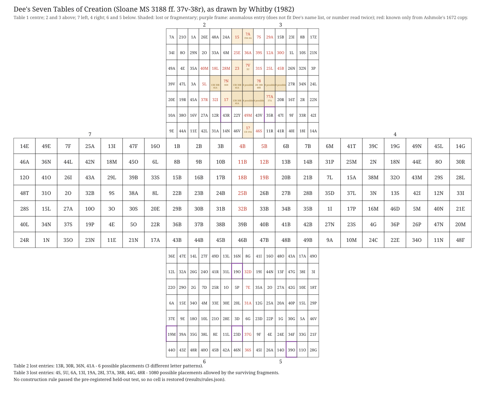

# The lost cells of John Dee's Seven Tables of Creation cannot be placed: a test of 20 layout rules

On 29 April 1582 John Dee drew seven tables of 7 × 7 cells, joined as a cross, from which the
names of 49 angels are read (British Library, Sloane MS 3188 ff. 37v–38r). The leaf is broken
along its fold, and some cells of tables 2 and 3 are lost. Every name is known, so the number
and letter of each lost entry are known too. What is lost is *which cell each one stood in*.

This study asks whether a construction rule for the tables could put them back. It lists the
lost entries cell by cell, counts the placements the surviving fragments allow, and tests 20
families of layout rules, fixed in advance, on cells hidden from them. None passes. The
evidence does not decide where the lost entries stood.

That is what Christopher Whitby wrote in 1982: since "there is no rule for individual
placings", the correct positions "cannot be ascertained". This study is a measured test of his
statement, and it agrees with him.

This is a study of a damaged manuscript table. It is not a decipherment, and no cell is
restored. Where the evidence is short of proof, this README says "the evidence weighs toward".

October 2026. CPU only. The rule search reruns in about an hour on 6 processes; every other
step takes seconds.

**The paper:** [`paper/dee-seven-tables.pdf`](paper/dee-seven-tables.pdf) (working paper,
4 pages, built from `paper/dee-seven-tables.typ` by `paper/build.sh`). The README covers the
same ground in more detail.

## In short

| Question | Answer | How firm |
|---|---|---|
| Can the drawing be read cell by cell? | Yes: 343 cells | Two eye reads differ at 2 cells, both settled at higher zoom; a machine witness agrees on 337 of 343 entries |
| Which entries are lost? | Table 2: 13R, 30R, 36N, 41A. Table 3: 4S, 5U, 6A, 13I, 19A, 28I, 37A, 38R, 44G, 48R | Exact: each table's absent numbers, with letters from Dee's own name list |
| How many placements do the fragments allow? | Table 2: 6. Table 3: 1,080 | Exhaustive enumeration |
| Does any of 20 layout rules predict hidden cells better than chance? | No | Best family: p = 0.013 before correction, 0.25 after (Holm, 20 families; 20,000 shuffled controls) |
| So can the lost cells be placed? | No. The evidence does not decide | As Whitby (1982) wrote |
| Anything left over? | Two patterns, kept as leads only: knight's moves in table 2, king's moves in table 4 | Picked by looking; neither holds up as a rule on hidden cells |



*The figure is our own drawing, made by `code/figure.py` from `data/cells.csv`; no manuscript
or thesis image is reproduced. Shaded cells are lost or fragmentary, with what survives and the
entries that could stand there. Purple frames mark anomalous entries (not fitting Dee's name list, or a number read twice).
Red glyphs are known only from Ashmole's 1672 copy.*

## 1. The problem

- **The source.** British Library, Sloane MS 3188 ff. 37b–38a (BL foliation ff. 37v–38r), the
  "action" of 29 April 1582.
- **The figure.** Seven 7 × 7 tables joined as a cross:
  - table 1 is in the centre, tables 2 and 3 above it, 7 to the left, 4 to the right, 6 and 5
    below;
  - each cell holds a number (1–49) and a letter;
  - table 1 is 1B … 49B in reading order. Table *t* holds letter *t* of each of the 49 names,
    tagged with the name's number. Name *k* is read by collecting the cells numbered *k* from
    the seven tables (for name 1, Baligon: B from table 1, A from table 2, L from table 3, and
    so on).
- **The damage.** The leaf is broken along the fold, at the inner edges of tables 2 and 3 (and
  slightly in tables 1 and 5).
  - Elias Ashmole copied the leaf in 1672 (Sloane MS 3677 ff. 57b–58a). He noted that "the
    spaces not filled up were decaied and broken away in the Originall".
  - Some entries he could still read have since been destroyed. Whitby drew those in red.
- **The question.** The name-reading rule uses only the numbers, so it says nothing about
  where a cell sits. Only a rule for how the tables were laid out could place the lost
  entries. Is there one?

## 2. Sources

None of the third-party sources is included here (see Licensing). `scripts/fetch_sources.sh`
downloads them and checks them against `sources/SHA256SUMS`. The analysis reads only `data/`.

| Source | Used for |
|---|---|
| Christopher Whitby, *John Dee's actions with spirits, 22 December 1581 to 23 May 1583* (PhD thesis, University of Birmingham, 1982), vol. II p. 121, open access at [etheses.bham.ac.uk/id/eprint/3149](https://etheses.bham.ac.uk/id/eprint/3149/) | His drawing of the cross: a colour scan at 416 ppi. Every cell here is read from it |
| Whitby vol. II pp. 127–129 | Dee's own list of the 49 names of the same day, the *Tabula Collecta* (Sloane MS 3188 f. 40a) → `data/names.csv` |
| Whitby vol. II p. vi §§14–16; vol. I pp. 339–340 | His conventions, and his commentary on the figure |
| "Alan", comment of 20 June 2025 on Nick Pelling's Cipher Mysteries post "John Dee's Tabula Angelorum Bonorum 49" | The only earlier list of lost cells we found; compared in §4 |

Details: `data/SOURCES.md`.

## 3. The transcription (`data/cells.csv`)

343 cells: table, row, column, number, letter, ink, state, note and source.

- **Two independent eye reads** (`data/reads.txt`), with different crops, zoom and order. They
  differ at 2 cells, both settled at higher zoom (`results/read_disagreements.json`):
  - table 6 r3c1: read 1 could not decide between 22D and 22O; it is 22O;
  - table 3 r7c2: read 1 missed that the 6 of 46S is red.
- **A machine witness.** The Claude API (Anthropic) read each whole table from a crop of the
  figure (12 calls, 0.12 USD in all; `results/claude_reads.json`, `results/claude_reads_b.json`).
  - Five of its first seven answers were refusals; a plainer prompt was then answered. Both
    prompts are recorded.
  - Its answers were parsed against a fixed format and never change a reading.
  - It agrees with the eye reading on **337 of 343** entries (`results/witness_compare.json`).
    Of the 6 differences, 3 are notation only (whether a lost leading digit is marked) and 3 are
    letter shapes: table 3 r2c4 30O (read C), table 5 r1c4 48O and table 6 r3c1 22O (read D).
    Whitby's O has a flattened left side, and the same shape is O in 49O and 29O beside them.
    All three were kept as O, and each also fits its name.
  - These reads are reported as recorded results. They are not part of the rerun.
- **What red means.** Whitby's commentary (vol. I p. 339) says he drew in red the letters and
  numbers that appear in Ashmole's copy but have since been destroyed in Dee's manuscript.
  Red is not Dee's red ink: the red cells all lie along the fold. Empty cells
  were already lost in 1672.

**Anomalies, kept exactly as read** (checked against Dee's own name list of the same day):

| Table | Cell | As read | Expected | Note |
|---|---|---|---|---|
| 2 | r6c6 | 43R | 43L (Blvmaza) | Dee's margin note "alr. R.R. 13 30" corrects it to 30R, and 12R (r6c5) to 13R (Whitby's reading) |
| 3 | r6c3 | 35R | 35L (Baldago) | Whitby: "'35R' is incorrect" |
| 5 | r7c5 | 39O | 39N (Buscnab) | |
| 6 | r6c1 | 19M | 17M (Bazpama) | 19 occurs twice in table 6, 17 not at all |
| 6 | r6c7 | 23D | 23O (Blisdon) | D is Blisdon's fifth letter |
| 4 | r7c5, r7c6 | [11N] 34O, [48F] 11N | | Dee's erased first entries; he had left out 34O and shifted the row (Whitby) |
| 7 | r5c6, r7c1 | [34] 30S, [14] 24R | | Dee's corrections; the corrected numbers fit the names |

In the analysis an anomalous cell stays where it is, is never hidden, and its number is not
used by any rule.

## 4. The lost entries

**Our list** (`results/placements.json`, exhaustive enumeration). A placement puts each number
absent from a table into one damaged cell, consistent with what survives in each cell:

| Table | Lost entries | Damaged cells | Fixed or narrowed by fragments | Placements |
|---|---|---|---|---|
| 2 | 13R, 30R, 36N, 41A | r4c5, r4c6 ("N"), r4c7, r5c7 | r4c6 = 36N | **6** (3 letter patterns) |
| 3 | 4S, 5U, 6A, 13I, 19A, 28I, 37A, 38R, 44G, 48R | r1c1 ("A"), r3c1 ("V"), r4c1, r4c2 ("8"), r4c3, r4c4, r5c1, r5c2, r5c3 ("7A"), r7c1 ("1") | r3c1 = 5U, r5c3 = 37A; r1c1 is 6A or 19A; r4c2 is 28I, 38R or 48R; r7c1 is 13I or 19A | **1,080** (300 letter patterns) |

- Table 2's red "15", "17" and "23" keep their numbers; only their letters (A, A, L) are lost.
  So they are not lost entries: their cells are known.
- **Two variants**, reported but not used:
  - with Dee's margin correction in table 2 applied, the lost entries become 12R, 36N, 41A and
    43L: still 6 placements;
  - if table 3's "35R" is a slip for 38R, the lost set has 35 instead of 38: 720 placements.

**Comparison with "Alan"** (Cipher Mysteries, comment of 20 June 2025), who lists table 2:
15A, 30R, 41A, and table 3: 18I, 19A, 38R, 44G, 48R.

- His counts match the wholly empty cells in Whitby's drawing: 3 in table 2 and 5 in table 3.
  The differences are in which entries he puts in them.
- **Table 2.** *15A* is not lost as an entry: the number 15 survives (red, from Ashmole's
  copy), and only its letter is lost. Whitby's commentary lists "'A' to go with 15" among the
  missing letters, which is the likely source. *13R* is missing from Alan's list, but no 13
  survives anywhere in table 2, so 13R is lost. *36N* is also missing, but only as a matter of
  counting: the surviving N can only be 36N.
- **Table 3.** *18I* is legible (black, r7c6), so it is not lost; the lost entries with I are 13I and
  28I.
  His other four (19A, 38R, 44G, 48R) are on our list. Five more are not on his: 4S, 5U, 6A,
  28I and 37A. All but 4S stand in cells with fragments, and Whitby's commentary reconstructs
  most of them ("'7A' should clearly be '37A'"). Alan seems to have counted only the wholly
  empty cells. *38R* follows Whitby's "the '8' is part of '38R'", but the "8" fits 28I and 48R
  as well, since its letter is lost.
- **In short**, Alan's lists look like a partial reading of Whitby's commentary. They do not
  point to a different witness.

**Whitby's own list** (vol. I p. 340) is right for table 2 (13R, 30R, 41A, with 36N "preceded
by" the surviving N). For table 3 it leaves out 13I and 28I and gives the "8" as 38R.

**Corrections to our own first pass.** An unpublished first-pass note (18 October 2026) worked
from a provisional reading. Two points in it were wrong and are corrected here:
- it took the red entries for Dee's red ink; they are readings known only from Ashmole's copy;
- it flagged table 7's "40L" as an anomaly, using the later spelling Bminpob; Dee's list of
  1582 spells the name Bminpol, so 40L is right.

## 5. Method (pre-registered)

The pre-registration (`results/preregistration.md`) was written and committed to the author's
working repository before any rule was scored on real data (19 October 2026, 11:30 UTC). That
repository is private, so readers cannot check the timing themselves; treat it as the author's
statement. The code is `code/rules.py`. All
random processes use the seed 20261019.

- **20 rule families.** Each turns the visible cells of a table into a prediction for hidden
  cells:
  - consecutive numbers placed by a chess-piece move (king, knight, wazir, ferz, dabbaba,
    alfil, camel, zebra; king and knight also on a wrap-around board);
  - *k* and *k*+7 placed side by side (the names come in groups of seven);
  - Latin-square and clustering tendencies of the group of seven and the place in the group;
  - a magic-square tendency;
  - affine maps mod 7 (two numberings);
  - reading orders with a stride (row, boustrophedon, spiral, diagonal; all rotations and
    reflections);
  - one table copying another, rotated, reflected, shifted, or with its numbers offset.
- **Held-out test.** In each of tables 2–7, 20 folds each hide 6 legible cells (720 hidden
  cells in all). Each family predicts them from the rest, and the score is the expected number
  it gets right (ties between equally good fits averaged).
- **Controls.** 20,000 copies of the six tables, each with its legible numbers shuffled among
  its legible cells; damaged and anomalous cells stay fixed. Each copy is scored the same way.
- **Decision.**
  - A family passes if its pooled score beats the controls at a Holm-corrected p < 0.05 over
    the 20 families.
  - Only then may it place lost cells, and only in a table where it also beats its controls
    on its own and gets at least half the hidden cells right (the gate).
  - **Stop rule:** if no family passes, stop, and report "the evidence does not decide".

## 6. Results

**The rule search** (`results/rules.json`; 6 processes, 61 minutes). Pooled over tables 2–7,
720 hidden cells. Chance is about 120 hidden cells right for the completion families and about
17 for the map families.

| Family | Hidden cells right | Controls (mean ± sd) | p | Holm p |
|---|---|---|---|---|
| cluster_q (groups of seven kept together) | 150.7 | 119.9 ± 12.9 | 0.013 | 0.25 |
| walk_knight | 147.0 | 120.0 ± 14.7 | 0.039 | 0.75 |
| walk_knight_torus | 143.5 | 119.9 ± 15.4 | 0.069 | 1 |
| walk_ferz | 139.2 | 120.0 ± 13.7 | 0.087 | 1 |
| walk_dabbaba | 130.7 | 119.9 ± 13.7 | 0.21 | 1 |
| walk_king | 129.2 | 119.9 ± 15.0 | 0.26 | 1 |
| affine_base0 | 21.3 | 16.9 ± 8.5 | 0.26 | 1 |
| 13 other families | at or near their controls | | ≥ 0.26 | 1 |

- **No family passes.** The stop rule applies, and no lost cell is placed.
- **Per table** (secondary; not part of the decision). 8 of the 120 per-table tests reach
  p < 0.05, about what chance gives (6). The strongest:
  - table 2, knight walk: 39.4 of 120 hidden cells right, against 20.1 (p = 0.0055). That is
    a hit rate of 0.33, below the 0.5 the gate asks for;
  - table 3, *k* and *k*+7 side by side: 42.1 against 20.0 (p = 0.0030).
- The sensitivity rerun with anomalies included was pre-registered only for a passing family,
  so it was not run.

**The two first-pass hints, as fixed tests** (`results/hints.json`; 100,000 shuffles). They
were first seen on the provisional reading: table 2, 11 knight pairs against about 4
(p = 0.001); table 4, 12 king pairs against about 6.4 (p = 0.019). On the checked transcription:

| Hint | Pairs | Expected | p | × 2 (both hints) | × 12 (all looks) |
|---|---|---|---|---|---|
| H1: table 2, consecutive numbers a knight's move apart | 10 of 38 | 3.9 | 0.0034 | 0.0068 | ≈ 0.04 |
| H2: table 4, consecutive numbers king-adjacent | 12 of 48 | 6.4 | 0.019 | 0.039 | ≈ 0.23 |

- Both survive the checked transcription, H1 a little weaker than first seen.
- But they were picked from 12 looks (knight and king moves in six tables) at nearly the same
  cells. Allowing for all 12 leaves H1 at about 0.04 and H2 at about 0.23, so neither is
  evidence of a rule. The other ten looks are at or near chance.
- The held-out test above is the fair test. It does not support either as a rule for the
  tables as a whole: the knight walk gets only a third of table 2's hidden cells right, and is
  not seen in the other tables.
- **They are leads, not findings.** For the record only: the knight-walk rule's two best
  placements in table 2 both put 13R at r5c7, a knight's move from 12 and 14.

## 7. Verdict

- **Which entries are lost is settled**, cell by cell, with 6 possible placements in table 2
  and 1,080 in table 3.
- **No construction rule was found.** None of 20 rule families, fixed in advance, predicts
  hidden cells better than the same tables with their numbers shuffled.
- **The evidence does not decide** where the lost entries stood. Table 1's plain order and the
  scattered look of tables 2–7 fit Whitby's view, and Alan's, that the layout was not made by
  a rule.

## 8. What is new, and earlier work

**Earlier work.**
- **Christopher Whitby** (1982) transcribed and drew the figure, marked in red what survives
  only in Ashmole's copy, read Dee's margin correction, listed most of the lost entries, and
  wrote: "It is possible to an extent to reconstruct the missing parts of the table, but since
  there is no rule for individual placings within each small square in tables 2-7, the correct
  positions of the missing letters in the original cannot be ascertained" (vol. I p. 340).
  Everything here rests on his drawing and commentary.
- **"Alan"** (Cipher Mysteries, 2025) listed lost cells and tried to place them; he wrote that
  "this line of inquiry has so far proved futile".
- **Searches on 18–19 October 2026** (the web, GitHub, Zenodo and Crossref) found no positional
  reconstruction and no test of a layout rule.
- **Not read:** Joseph Peterson's edition, *John Dee's Five Books of Mystery* (2003), and its
  later edition; studies by Harkness, Asprem and Laycock (print only).

**What this study adds**, as far as our searches found:
1. A cell-level, machine-readable transcription of the figure, with two eye reads and a
   machine witness, and with the anomalies kept as read.
2. A complete list of the lost entries with exact placement counts (6 and 1,080), and the
   reasons Alan's list and Whitby's own table 3 list differ from it.
3. A pre-registered, controlled test of 20 layout-rule families on hidden cells. It finds
   none. This turns Whitby's judgment into a measured negative result.

## 9. What a second witness could and could not settle

The drawing is clear; these are not unclear digits. They are cells where the manuscript or
Ashmole's copy might hold more than Whitby recorded:
- table 3 r4c2: the "8" (28, 38 or 48);
- table 3 r1c1: the "A" (6 or 19);
- table 3 r7c1: the "1" (13 or 19);
- Dee's margin note by table 2;
- the anomalies in tables 3, 5 and 6, which could be slips by Dee, by Ashmole or in the
  drawing.

The witnesses would be British Library images of Sloane MS 3188 ff. 37v–38r and Sloane MS 3677
ff. 57b–58a, or Peterson's edition. Even with all of them, table 3 would keep at least its
wholly empty cells unplaced. **No witness can place an entry in a cell that was already empty
in 1672; only a rule could, and none was found.**

## 10. Caveats

- **One drawing only.** The transcription is of Whitby's drawing, not of the manuscript. A slip
  by Whitby would carry through. The machine witness checks our reading of his drawing, not his
  reading of Dee.
- **What the test can and cannot show.** A rule outside the 20 families could exist. The test
  shows only that none of the usual constructions (walks, squares, maps, reading orders,
  copies) is supported.
- **Lost cells stay lost.** Even a strong rule could only weigh toward a placement; the cells
  are physically gone.

## 11. How to reproduce

Needs Linux or macOS with Python 3 and numpy (the published results used Python 3.13 and numpy
2.5.4), `curl`, and `pdfimages` (poppler) to extract the figure.

```
scripts/fetch_sources.sh sources/downloads    # Whitby's thesis, about 34 MB; checks SHA-256
uv run --no-project --python 3.13 --with numpy==2.5.4 code/run_all.sh   # about an hour on 6 processes
git diff --stat                               # see below for the fields that differ
```

- `run_all.sh` rebuilds `data/cells.csv` from the two eye reads, then the witness comparison,
  the hints, the rule search, the placements and the figure. The rule search runs under
  `nice -n 19`; `PROCS=n` sets the number of processes, and the results do not depend on it.
- The Claude API reads are recorded results, not rerun (they need an API key and the crops).
- The fetched sources are for checking the transcription against the drawing; the analysis
  itself reads only `data/`.
- **Checked from a clean clone on 19 October 2026:** every rebuilt file was byte for byte the
  same as the published one except for two run-record fields, `code_commit` (the commit the
  run was made from) and, in `rules.json`, `elapsed_s` (the run time). In the published files
  `code_commit` names a commit of the author's private working repository; the code here is
  the same code, without the scripts that made the API calls.
- **Differences from the working record**, all made for publication and none touching a number:
  - `results/claude_reads*.json` had two internal bookkeeping fields (a spend-ledger path and
    id) removed, and `results/witness_compare.json` records the SHA-256 of the files as
    published;
  - `code/figure.py` was adjusted so the labels fit the narrow cells (options in two lines, a
    little more room under the heading); the drawn content is unchanged;
  - in `results/preregistration.md` a reference to an unpublished internal note is replaced by
    a description of it (marked at the top of the file).

## Licensing

- **Code** (`code/`, `scripts/`): MIT, see `LICENSE`.
- **Our data and results** (`data/`, `results/`, the figure, the paper): CC BY 4.0
  (https://creativecommons.org/licenses/by/4.0/). `data/cells.csv`, `data/reads.txt` and
  `data/names.csv` are our own record of a sixteenth-century table and name list, read from
  Whitby's drawing and transcription; please cite Whitby (1982) as their source as well as this
  repository.

**Left out, and why:**
- **Whitby's thesis** (PDFs and the figure image): open access, but copyright stays with the
  author. Not redistributed; `scripts/fetch_sources.sh` downloads it from the University of
  Birmingham repository. Whitby is quoted only briefly.
- **The table crops sent to the API**: cut from Whitby's figure, so not included. Their SHA-256
  sums are in `results/claude_reads*.json`.
- No manuscript or thesis images are included. The figure in `results/` is our own drawing.

## Acknowledgements

This study stands on Christopher Whitby's transcription, drawing and commentary. The analysis
code was written with the help of an AI coding assistant (Claude, Anthropic), and the Claude
API served as one transcription witness. The author checked the results and is responsible for
any errors.

## References

- British Library, Sloane MS 3188 (Dee's actions, 1581–1583), ff. 37b–38a and 40a; Sloane MS
  3677 (Ashmole's transcript, 1672), ff. 57b–58a.
- Christopher Whitby, *John Dee's actions with spirits, 22 December 1581 to 23 May 1583*, PhD
  thesis, University of Birmingham, 1982, 2 vols.
  https://etheses.bham.ac.uk/id/eprint/3149/
- "Alan", comment of 20 June 2025 on Nick Pelling, "John Dee's Tabula Angelorum Bonorum 49",
  Cipher Mysteries, 8 June 2025.
  https://ciphermysteries.com/2025/06/08/john-dees-tabula-angelorum-bonorum-49
- Joseph H. Peterson (ed.), *John Dee's Five Books of Mystery* (Weiser, 2003) (not read for
  this study).

## How to cite

Burford, B. (2026). The lost cells of John Dee's Seven Tables of Creation cannot be placed: a
test of 20 layout rules (version 1.0). https://github.com/BravoBravoIX/dee-seven-tables
